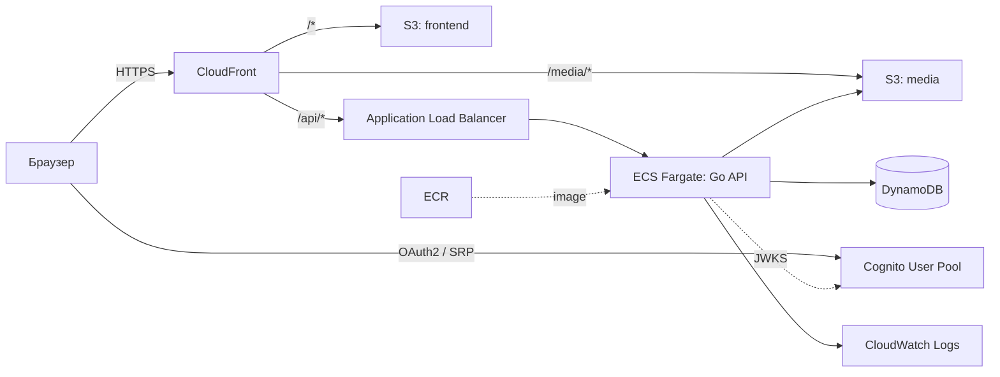
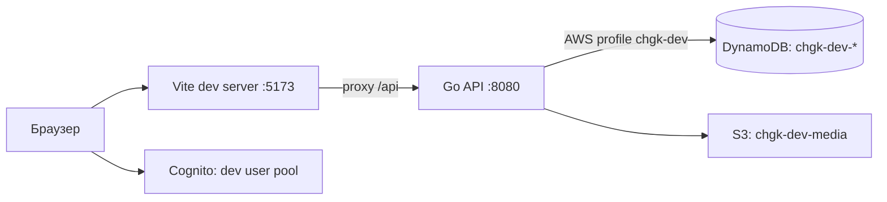

# 02 — Архитектура

## Обзор

Классическая трёхзвенная архитектура: SPA → REST API на Go → DynamoDB. Аутентификация — Cognito (JWT), медиа (раздатки, изображения сущностей) — S3.

Одна кодовая база работает в двух режимах:

- **Локально**: frontend (Vite dev server) и backend (`go run`) на машине разработчика; DynamoDB, Cognito и S3 — dev-окружение в AWS.
- **В AWS (prod)**: frontend в S3 за CloudFront, backend — контейнер в ECS Fargate за ALB.

## Облачная схема (prod)

Ключевые моменты:

- **Единый домен** через CloudFront: `/` — SPA, `/api/*` — ALB, `/media/*` — S3. Нет CORS в проде, одни cookies/заголовки.
- **ALB принимает трафик только от CloudFront** (managed prefix list `com.amazonaws.global.cloudfront.origin-facing` + секретный заголовок).
- **ECS-задачи в публичных подсетях** с публичным IP, но security group пускает только ALB. Это позволяет обойтись без NAT Gateway (~$35/мес). DynamoDB и S3 доступны через бесплатные Gateway VPC Endpoints.
- **Backend stateless** — масштабирование горизонтальное, количество задач задаётся в Terraform.

## Локальная схема

- Vite проксирует `/api` на `localhost:8080` — поведение как в проде (единый origin).
- Backend использует стандартную цепочку учётных данных AWS SDK (`AWS_PROFILE`).
- Таблицы dev и prod разделены префиксом (`chgk-dev-*`, `chgk-prod-*`) и, в идеале, разными AWS-аккаунтами.
- Опционально — бэкенд в Docker (`docker compose up api`) с пробросом `~/.aws`, чтобы проверить контейнер перед деплоем.

## Компоненты

| Компонент | Ответственность |
|---|---|
| `frontend` | UI, маршрутизация, аутентификация через Cognito, кэш серверного состояния (React Query), локальное состояние тренировки (TanStack Store) |
| `backend/cmd/api` | REST API: CRUD контента, тренировки, повторение, статистика; проверка JWT; авторизация по группам |
| `backend/cmd/importer` | CLI импорта вопросов (db.chgk.info, файлы); та же логика доступна через API для админа |
| DynamoDB | Контент (турниры, вопросы), база знаний, пользовательские данные |
| S3 media | Изображения раздаток и сущностей |
| Cognito | Регистрация, вход, группы `editor`/`admin` |

## Сквозные вопросы

### Аутентификация и авторизация

1. Frontend логинится в Cognito (Amplify Auth, SRP), получает ID/Access token.
2. Каждый запрос к API несёт `Authorization: Bearer <access_token>`.
3. Backend валидирует подпись по JWKS пула (кэшируется), `iss`, `token_use`, `client_id`, срок действия.
4. `sub` — идентификатор пользователя; `cognito:groups` — роли.

### Поиск

DynamoDB не умеет полнотекстовый поиск. Стратегия поэтапная (см. [ADR-0004](adr/0004-search.md)):

1. MVP — фильтрация по GSI (турнир, год, сложность, тег) + поиск по префиксу названия сущностей.
2. Далее — встроенный полнотекстовый индекс (Bleve) в Go-сервисе, который строится из DynamoDB и хранится в S3; ECS-задача загружает его при старте и обновляет инкрементально.
3. При росте — Amazon OpenSearch Serverless (дорого, только при реальной необходимости).

### Наблюдаемость

- Структурированные логи (`log/slog`, JSON) → CloudWatch Logs.
- `request_id` в каждом логе и в заголовке ответа `X-Request-Id`.
- Health-check `GET /api/health` для ALB.
- Метрики ALB/ECS/DynamoDB — стандартные CloudWatch; алерты на 5xx и throttling.

### Конфигурация

Только через переменные окружения (12-factor). Локально — `.env` файлы (не коммитятся), в AWS — переменные task definition; секретов в приложении практически нет (доступ к AWS — через IAM role задачи).
