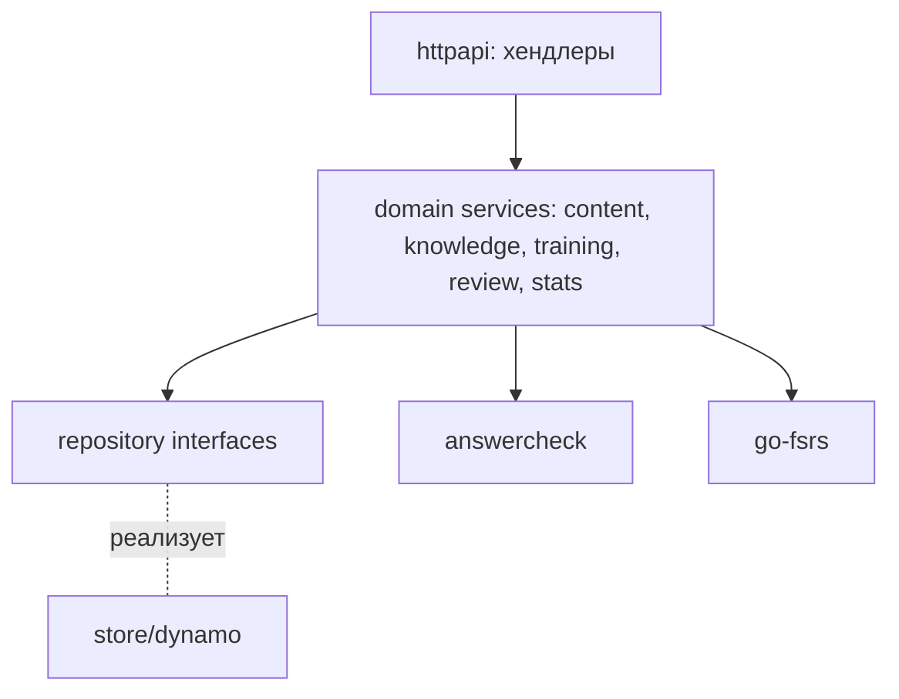

# 05 — Backend (Go)

## Технологии

| Задача | Выбор |
|---|---|
| Язык | Go 1.23+ |
| HTTP-роутер | `github.com/go-chi/chi/v5` |
| Генерация из OpenAPI | `github.com/oapi-codegen/oapi-codegen/v2` (strict server, chi) |
| AWS | `github.com/aws/aws-sdk-go-v2` (`dynamodb`, `s3`, `feature/dynamodb/attributevalue`) |
| JWT / JWKS | `github.com/lestrrat-go/jwx/v2` |
| Повторение | `github.com/open-spaced-repetition/go-fsrs` |
| ID | `github.com/oklog/ulid/v2` |
| Логи | `log/slog` (JSON-handler) |
| Конфиг | `github.com/caarlos0/env/v11` |
| Линт | `golangci-lint` |
| Тесты | `testing` + `testify`; интеграционные — против dev-таблиц с уникальным префиксом |

## Структура

```text
backend/
├── cmd/
│   ├── api/            # HTTP-сервер (точка входа ECS-контейнера)
│   ├── importer/       # CLI импорта
│   └── migrate/        # Одноразовые миграции данных
├── internal/
│   ├── config/         # Загрузка env-конфигурации
│   ├── httpapi/        # Сгенерированный код + реализация хендлеров, middleware
│   │   ├── gen/        # oapi-codegen output (не редактируется руками)
│   │   └── middleware/ # request id, логирование, recover, auth, rate limit
│   ├── auth/           # Проверка Cognito JWT, Principal{Sub, Groups}
│   ├── content/        # Домен: турниры, вопросы (service + repository interface)
│   ├── knowledge/      # Домен: сущности, факты, связи
│   ├── training/       # Сессии, попытки, проверка ответов
│   ├── review/         # Карточки и FSRS
│   ├── stats/          # Агрегаты
│   ├── importer/       # Парсеры (chgkdb, 4s, json) → доменные модели
│   ├── answercheck/    # Нормализация и нечёткое сравнение ответов
│   ├── store/dynamo/   # Реализации репозиториев на DynamoDB, ключи, курсоры
│   └── media/          # Presigned URL для S3
├── Dockerfile          # multi-stage, итог — distroless/static
└── go.mod
```

## Слои



- **Хендлеры** — только маппинг DTO ↔ доменные модели и коды ответов.
- **Сервисы** — бизнес-правила, авторизация на уровне ресурсов, транзакции.
- **Репозитории** — интерфейсы в доменных пакетах; реализация в `store/dynamo`. Знание о ключах (`PK`, `GSI1SK` и т.д.) не выходит за пределы `store/dynamo`.
- Зависимости собираются вручную в `cmd/api/main.go` (без DI-фреймворков).

## Конфигурация (env)

| Переменная | Пример | Описание |
|---|---|---|
| `APP_ENV` | `local` / `prod` | Окружение |
| `HTTP_ADDR` | `:8080` | Адрес сервера |
| `AWS_REGION` | `eu-central-1` | Регион |
| `AWS_PROFILE` | `chgk-dev` | Только локально; в ECS — IAM role задачи |
| `DDB_TABLE_PREFIX` | `chgk-dev` | Префикс таблиц → `chgk-dev-content` и т.д. |
| `MEDIA_BUCKET` | `chgk-dev-media` | Бакет медиа |
| `COGNITO_USER_POOL_ID` | `eu-central-1_XXXX` | Пул пользователей |
| `COGNITO_CLIENT_ID` | `xxxx` | App client SPA |
| `AUTH_DEV_BYPASS` | `false` | Только при `APP_ENV=local`: принимать заголовок `X-Dev-User` вместо JWT (оффлайн-отладка) |
| `CORS_ORIGINS` | `http://localhost:5173` | Обычно не нужен (Vite proxy), оставлен для отладки |
| `LOG_LEVEL` | `info` | Уровень логов |

> [!CAUTION]
> `AUTH_DEV_BYPASS` при `APP_ENV != local` приводит к отказу старта сервиса — проверка в `config`.

## Middleware (порядок)

1. `RequestID` — генерирует/прокидывает `X-Request-Id`.
2. `Recoverer` — паника → 500 problem+json.
3. `Logger` — метод, путь, статус, длительность, `sub`.
4. `Auth` — валидирует JWT, кладёт `Principal` в контекст (кроме `/api/health`).
5. `RateLimit` — на пользователя, in-memory token bucket (достаточно при 1–2 задачах).
6. Проверка ролей — декларативно в хендлерах (`requireGroup(ctx, "editor")`).

## Работа с DynamoDB

- Клиент создаётся один раз; ретраи — встроенные в SDK (adaptive).
- Курсор = base64(JSON(`LastEvaluatedKey`)) + HMAC, чтобы клиент не мог подделать ключ к чужой партиции.
- Многоэлементные записи — `TransactWriteItems` (≤ 100 элементов); импорт больших турниров — батчами `BatchWriteItem` с повтором `UnprocessedItems`.
- Оптимистичная блокировка: `ConditionExpression: version = :expected`, ошибка → 409.

## Сборка и запуск

```powershell
# генерация кода из OpenAPI
go generate ./...

# локальный запуск
go run ./cmd/api

# контейнер
docker build -t chgk-api ./backend
```

Dockerfile: стадия `golang:1.23` → `CGO_ENABLED=0 go build -trimpath -ldflags "-s -w"` → `gcr.io/distroless/static-debian12:nonroot`. Платформа образа — `linux/arm64` (Fargate Graviton дешевле).

## Graceful shutdown

ECS посылает `SIGTERM` → сервер прекращает принимать соединения, ждёт завершения активных запросов (`http.Server.Shutdown`, таймаут 20 с; `stopTimeout` в task definition — 30 с).
