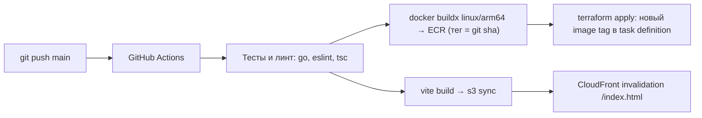

# 07 — Инфраструктура (AWS + Terraform)

## Окружения

| Окружение | Назначение | Ресурсы |
|---|---|---|
| `dev` | Локальная разработка (приложение запускается на машине разработчика) | DynamoDB-таблицы, Cognito, S3 media, IAM-политика для разработчика |
| `prod` | Боевое окружение | Всё из `dev` + VPC, ALB, ECS Fargate, ECR, S3 frontend, CloudFront, (опц.) Route 53 + ACM, алерты |

> [!TIP]
> Рекомендуется держать `dev` и `prod` в **разных AWS-аккаунтах** (AWS Organizations). Минимальный вариант — один аккаунт, разделение префиксом `chgk-dev-*` / `chgk-prod-*` и IAM-политиками.

Регион по умолчанию — `eu-central-1` (переменная `aws_region`). Сертификат для CloudFront создаётся в `us-east-1` (требование CloudFront).

## Структура

```text
infra/
├── bootstrap/                # Один раз: S3-бакет для Terraform state (+ GitHub OIDC-роль)
├── modules/
│   ├── dynamodb/             # 3 таблицы: content, knowledge, userdata (ключи, GSI, TTL, PITR, streams)
│   ├── cognito/              # User pool, SPA app client, группы editor/admin
│   ├── media/                # S3-бакет медиа (private, CORS для presigned PUT)
│   ├── network/              # VPC, 2 публичные подсети, gateway endpoints DynamoDB/S3
│   ├── ecr/                  # Репозиторий образов + lifecycle policy
│   ├── ecs-api/              # Cluster, task definition, service, ALB, target group, SG, IAM, логи, автоскейлинг
│   ├── frontend/             # S3 для SPA, CloudFront (origins: S3, ALB, media), OAC, SPA-fallback
│   ├── dns/                  # (опц.) Route 53 записи, ACM-сертификаты
│   └── monitoring/           # Алармы CloudWatch → SNS (email)
└── envs/
    ├── dev/                  # main.tf: dynamodb + cognito + media + developer IAM
    └── prod/                 # main.tf: все модули
```

## State

- Бэкенд `s3` с нативной блокировкой (`use_lockfile = true`, Terraform ≥ 1.10) — отдельная таблица DynamoDB для lock не нужна.
- Бакет создаётся модулем `infra/bootstrap` (локальный state, выполняется один раз), версионирование и шифрование включены.
- Ключи state: `chgk/dev/terraform.tfstate`, `chgk/prod/terraform.tfstate`.

## Ключевые ресурсы `prod`

### Сеть

- VPC `/16`, 2 публичные подсети в разных AZ (ALB требует минимум 2).
- **Без NAT Gateway**: задачи ECS получают публичный IP (для доступа к ECR, Cognito JWKS, CloudWatch), входящий трафик разрешён только от SG ALB.
- Gateway VPC Endpoints для DynamoDB и S3 (бесплатные) — трафик к БД не выходит в интернет.

### ECS

- Fargate, платформа `ARM64`, задача 0.25 vCPU / 0.5 GB (стартовое значение), `desired_count = 1` (минимально) — 2 для отказоустойчивости.
- Task role: доступ только к таблицам `chgk-prod-*` (и их индексам) и бакету медиа.
- Execution role: pull из ECR, запись логов.
- Логи — CloudWatch Log Group `/chgk/prod/api`, retention 30 дней.
- Deployment circuit breaker с откатом; health check ALB — `/api/health`.
- Автоскейлинг по CPU (target 60 %), 1–3 задачи.

### ALB

- HTTPS-листенер (ACM) или HTTP, если трафик идёт только от CloudFront (тогда шифрование CloudFront → ALB — через HTTPS с сертификатом на поддомен `origin.<domain>`).
- SG: входящий только из managed prefix list CloudFront.
- Правило листенера требует секретный заголовок `X-Origin-Verify`, который добавляет CloudFront; остальные запросы → 403.

### CloudFront

| Behavior | Origin | Кэш |
|---|---|---|
| `/api/*` | ALB | Без кэша (`CachingDisabled`), все заголовки/query → origin (`AllViewerExceptHostHeader`) |
| `/media/*` | S3 media (OAC) | Долгий кэш |
| `/*` (default) | S3 frontend (OAC) | `index.html` — без кэша, ассеты с хешем — 1 год |

SPA-fallback: CloudFront Function переписывает запросы без расширения на `/index.html` (вместо custom error responses, чтобы не маскировать 404 от API).

### Cognito

- User pool: вход по email, подтверждение email, политика паролей.
- App client для SPA: без секрета, SRP, токены: access 1 ч, refresh 30 дней.
- Группы: `editor`, `admin`.
- Задел: Google как identity provider + Hosted UI.

### DynamoDB

- On-demand; в prod — PITR и `deletion_protection_enabled = true`.
- Streams на `content` и `knowledge` (под будущий поиск).
- TTL-атрибут `expiresAt`.

## Деплой



- Доступ GitHub Actions к AWS — через **OIDC-роль** (без долгоживущих ключей), создаётся в `infra/bootstrap`.
- Тег образа передаётся в Terraform переменной `api_image_tag` — task definition всегда отражает состояние кода.
- Ручной деплой с локальной машины — `./scripts/deploy.ps1 -Env prod` (те же шаги).

## Ориентировочная стоимость prod (малая нагрузка)

| Ресурс | ≈ USD/мес |
|---|---|
| ALB | 18–20 |
| Fargate ARM 0.25 vCPU / 0.5 GB × 1 | 7–8 |
| Публичный IPv4 (ALB ×2, задача ×1) | ~11 |
| DynamoDB on-demand + PITR | 1–5 |
| CloudFront, S3, Cognito (до 10k MAU бесплатно\*), CloudWatch | 1–5 |
| **Итого** | **≈ 40–50** |

\* Условия бесплатного уровня Cognito зависят от тарифа (Lite/Essentials) — проверить актуальные цены перед запуском.
