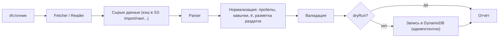

# 09 — Импорт вопросов

## Источники

| Источник | Способ | Статус |
|---|---|---|
| [db.chgk.info](https://db.chgk.info) — «База вопросов» | HTTP: XML/JSON-выгрузка турнира по идентификатору | MVP |
| Файл в формате 4s (формат `chgksuite`) | Загрузка через UI или CLI | MVP |
| JSON в формате приложения | Загрузка через UI или CLI | MVP |
| [gotquestions.online](https://gotquestions.online) | Исследовать наличие API и условия использования | Позже |

> [!WARNING]
> Перед массовым импортом уточнить условия использования источников. Всегда сохраняем ссылку на источник, авторов и редакторов. Запросы к внешним сайтам — с ограничением частоты (не чаще 1 запроса в секунду) и кэшированием сырых ответов.

## Конвейер



- **Fetcher** — `chgkdb`: загрузка дерева турнира (турнир → туры → вопросы).
- **Parser** — по одному на формат, на выходе — общая модель `ImportedTournament` (турнир, туры, вопросы).
- **Нормализация** — единые кавычки «ёлочки», схлопывание пробелов, выделение раздатки в отдельное поле, извлечение ссылок на изображения (скачиваются и кладутся в S3 media).
- **Идемпотентность** — элемент `SOURCE#<system>#<externalId>` создаётся с условием `attribute_not_exists`; повторный импорт → 409 или режим `--update` (перезапись с сохранением `qid`).
- **Отчёт** — количество турниров/вопросов, предупреждения (пустой ответ, нераспознанные поля), ссылки на созданные объекты.

## Соответствие полей

| Поле приложения | db.chgk.info | 4s |
|---|---|---|
| `text` | Вопрос | `?` |
| `handout` | Раздаточный материал (внутри текста, `<раздатка>` / изображение) | `[Раздаточный материал: …]` / `(img …)` |
| `answer` | Ответ | `!` |
| `accepted[]` | Зачёт | `=` |
| `rejected[]` | Незачёт | `!=` |
| `comment` | Комментарий | `/` |
| `sources[]` | Источник(и) | `^` |
| `authors[]` | Автор(ы) | `@` |
| Турнир / тур | Метаданные турнира и тура | `###` (заголовок), `#` (метаданные), `##` (тур) |

> [!NOTE]
> Точные имена XML-полей db.chgk.info и полная спецификация 4s фиксируются при реализации парсеров по реальным образцам; образцы кладутся в `backend/internal/importer/testdata/` и используются в golden-тестах.

## Интерфейсы

**CLI** (`backend/cmd/importer`):

```powershell
go run ./cmd/importer chgkdb --ids 12345,67890 [--dry-run] [--update]
go run ./cmd/importer file ./pack.txt --format 4s [--dry-run]
go run ./cmd/importer file ./pack.json --format json
```

**API** (admin): `POST /api/v1/import/chgkdb`, `POST /api/v1/import/file` — запускают задание в горутине сервера, статус хранится в `content` (`PK=IMPORTJOB#<id>`, TTL 7 дней) и опрашивается через `GET /api/v1/import/jobs/{jobId}`.

## Автоматические теги и сложность

- Теги при импорте не проставляются (в источниках их обычно нет). Позже — полуавтоматическая разметка (словари ключевых слов, LLM-подсказки с подтверждением редактором).
- Сложность — из метаданных турнира, если есть; иначе вычисляется по статистике взятий в приложении (`stats.correct / stats.plays`) после накопления данных.
