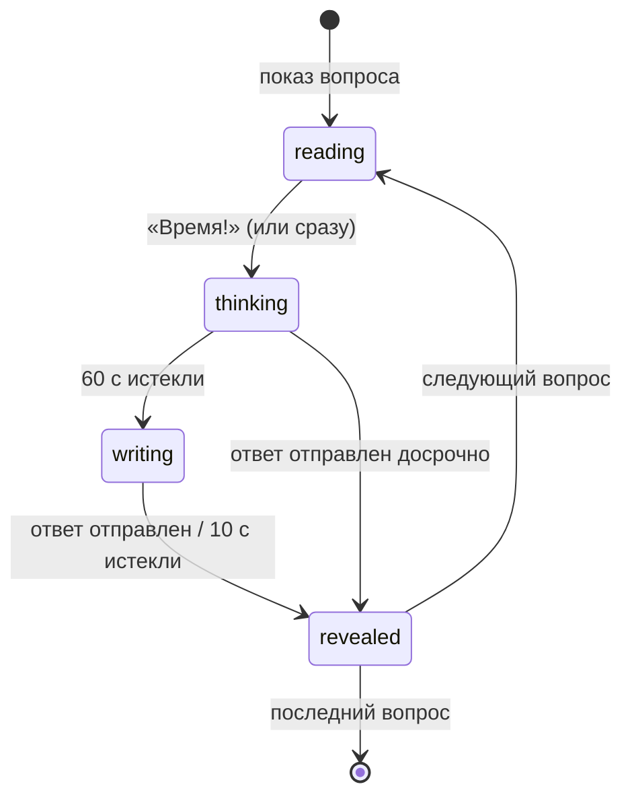

# 10 — Тренировки и повторение

## Блиц на время

1. Пользователь задаёт параметры: количество вопросов (по умолчанию 12), сложность, годы, теги, «исключать виденные», таймер.
2. Сервер подбирает вопросы (C6 + U5 из [модели данных](03-data-model.md)) и создаёт сессию.
3. Для каждого вопроса фазы:

- `reading` — опционально: вопрос «зачитывается» (текст появляется постепенно или пользователь сам нажимает «Время!»).
- `thinking` — 60 с (настраивается: 20 с для блиц-вопросов, 0 — без таймера).
- `writing` — 10 с на запись ответа.
- `revealed` — показываются ответ, зачёт, комментарий, источники, связанные сущности; пользователь подтверждает вердикт и может добавить вопрос/факты в повторение.

## Отыгрыш пакета

- Турнир целиком в исходном порядке, туры с паузами между ними.
- Прогресс сохраняется — можно продолжить позже (`status=active`).
- Итог: взято X из Y, по турам; лучший результат пишется в `TPLAY#<tid>`.
- Позже — сравнение с результатами команд на турнире (если источник даёт такие данные) и с другими пользователями приложения.

## Проверка ответов

Автоматическая проверка — подсказка, окончательное решение — за игроком (в ЧГК зачёт часто зависит от смысла).

Алгоритм `answercheck`:

1. Нормализация: нижний регистр, `ё→е`, удаление кавычек, пунктуации, лишних пробелов; удаление необязательных частей ответа в квадратных скобках из эталона.
2. Сравнение с `answer` и каждым элементом `accepted[]`:
   - точное совпадение после нормализации → `match`;
   - совпадение после стемминга (Snowball, русский) или расстояние Дамерау–Левенштейна ≤ 15 % длины → `close`;
   - иначе → `miss`.
3. Совпадение с `rejected[]` → всегда `miss`.

Интерфейс: `match` — предвыбрано «Верно», `close` — подсветка «Похоже, проверьте», `miss` — предвыбрано «Неверно». Игрок подтверждает одним нажатием.

## Интервальное повторение (FSRS)

### Что повторяется

| Тип карточки | Лицевая сторона | Обратная сторона |
|---|---|---|
| `Q` — вопрос | Текст вопроса (+ раздатка) | Ответ, зачёт, комментарий |
| `F` — факт | Вопрос-подсказка к факту (например, «Кто…?») или факт с пропуском | Полный факт + сущность |

Факты получают поле `prompt` (формулировка для лицевой стороны); если его нет — показывается название сущности и просьба вспомнить факты.

### Как карточки попадают в повторение

- Вручную — кнопка «В повторение» на вопросе или факте.
- Автоматически (настраивается) — каждый невзятый в тренировке вопрос.

### Алгоритм

- Используется **FSRS** (`go-fsrs`) с параметрами по умолчанию; целевая вероятность вспоминания (`requestRetention`) — 0.9, настраивается в профиле.
- Оценки: `again`, `hard`, `good`, `easy`.
- После оценки сервер пересчитывает состояние карточки, обновляет `due` и `GSI1SK`, пишет `REVIEW#` в лог (транзакция).
- Дневные лимиты: новых карточек — 20, повторений — 200 (настраиваются).
- Лог повторений позволит в будущем подобрать персональные параметры FSRS.

### Очередь

`GET /review/queue` возвращает карточки с `due <= now`, затем новые карточки в пределах дневного лимита. Порядок — по `due`, с перемешиванием внутри дня, чтобы не шли подряд факты одной сущности.

## Статистика

При каждом подтверждённом вердикте атомарно обновляются агрегаты `STATS#ALL`, `STATS#DAY#…`, `STATS#MONTH#…`, `STATS#TAG#…` и глобальные `stats` вопроса. Дашборд строится только из агрегатов — без сканирования попыток.
